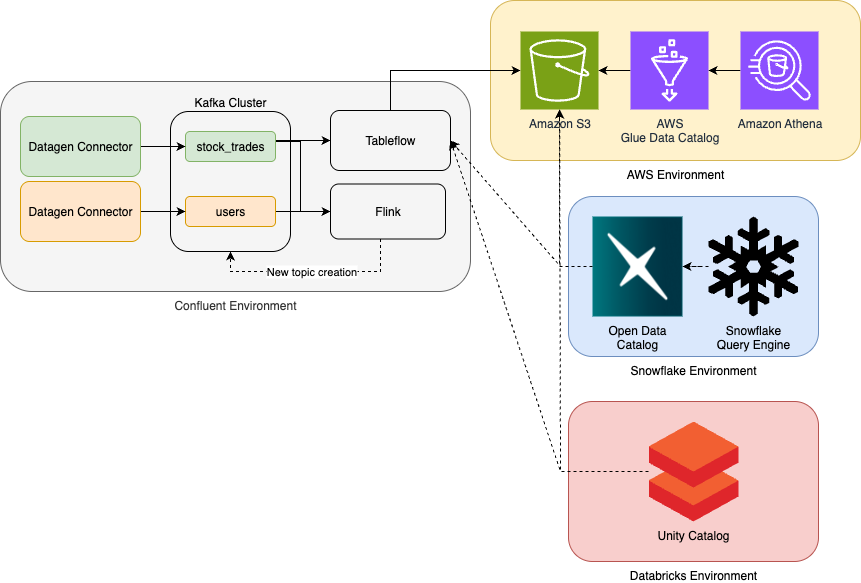

# Tableflow Terraform Demo

This project contains Terraform scripts to provision and configure a modern data pipeline using Confluent Cloud with support for both AWS and Azure cloud providers, and (optionally) Databricks and Snowflake. It automates the creation of Kafka topics, cloud storage, identity/access management, and all necessary integrations for Tableflow and streaming analytics.

## Overview

This Terraform project will:
- Create and configure Confluent Cloud environments, Kafka clusters, topics, and API keys.
- Set up cloud storage (AWS S3 or Azure ADLS Gen2) and identity/access management (AWS IAM or Azure Service Principal) for secure data storage and access.
- Integrate with Databricks and/or Snowflake for downstream analytics (optional).
- Support catalog integrations: AWS Glue, Azure Microsoft Fabric, Databricks Unity Catalog, Snowflake Polaris.
- Provision sample data generators and schema registry resources.
- Manage all resources as code for easy reproducibility and teardown.

## Multi-Cloud Support

This project supports deploying infrastructure on either **AWS** or **Azure** cloud providers. You can choose your cloud provider by setting the `cloud_provider` variable in your `terraform.tfvars` file.

### Cloud Provider Selection

- **AWS** (default): Uses S3 for storage, IAM roles for access control, and supports Glue catalog integration
- **Azure**: Uses ADLS Gen2 for storage, Service Principals for access control, and supports Microsoft Fabric catalog integration
- **Both**: Support Databricks Unity Catalog and Snowflake Polaris catalog integrations

### Backward Compatibility

Existing AWS deployments continue to work without any changes to your `terraform.tfvars` file. The `cloud_provider` variable defaults to "aws" for backward compatibility.

## Architecture




## Prerequisites

### Required for All Deployments
- **Confluent Cloud Account**: Sign up at https://confluent.cloud/ if you don't have one.
- **Confluent CLI**: Install from https://docs.confluent.io/confluent-cli/current/install.html#cli-install.
   > Run `confluent login` to set the proper auth credentials.
- **Terraform**: Install Terraform (v1.0 or newer) from https://developer.hashicorp.com/terraform/downloads

### AWS Deployments (cloud_provider = "aws")
- **AWS Account**: Sign up at https://aws.amazon.com/ if you don't have one.
- **AWS CLI**: Install from https://docs.aws.amazon.com/cli/latest/userguide/getting-started-install.html

### Azure Deployments (cloud_provider = "azure")
- **Azure Account**: Sign up at https://azure.microsoft.com/ if you don't have one.
- **Azure CLI**: Install from https://learn.microsoft.com/en-us/cli/azure/install-azure-cli
- **Azure Resource Group**: You'll need an existing resource group or permissions to create one

### Optional (for Databricks integration)
- **Databricks CLI**: Install using pip:
   ```sh
   pip install databricks-cli
   ```
   For more details, see the [Databricks CLI documentation](https://docs.databricks.com/en/dev-tools/cli/index.html).

--------------

### Initial Setup

#### For AWS Deployments

1. **Configure AWS CLI**
   Run:
   ```sh
   aws configure
   ```
   Enter your AWS Access Key, Secret Key, region, and output format.

#### For Azure Deployments

1. **Configure Azure CLI**
   Run:
   ```sh
   az login
   az account set --subscription "YOUR_SUBSCRIPTION_ID"
   ```
   This will authenticate you with Azure and set your active subscription.

2. **Create or identify an Azure Resource Group**
   If you don't have an existing resource group:
   ```sh
   az group create --name tableflow-rg --location eastus
   ```
   Update the `azure_resource_group_name` variable in your `terraform.tfvars` to match.

----------------

#### Optional Configuration

1. **Configure Databricks CLI** (if using Databricks resources)
   Run:
   ```sh
   databricks configure
   ```

   **How to find Databricks Host (databricks_host):**
   - Log in to your Databricks workspace.
   - Copy the URL from your browser's address bar.
   - Example: https://dbc-xxxxxx-yyyy.cloud.databricks.com
   - Use this as the value for databricks_host.

   **How to find personal access token:**
   - In the Databricks console, click your user icon (top right) and select User Settings.
   - Go to the Access Tokens tab.
   - Click Generate New Token, give it a name, and copy the generated token.
   - Use this as the value for databricks_token.

3. **Get Confluent Cloud Credentials**  
- Log in to Confluent Cloud.
- Create an API Key and Secret for your environment (see Confluent Cloud documentation).

4. **Clone this repository**  
   ```sh
   git clone <your-repo-url>
   cd tableflow-project
   ```

----------------

## Required Variables

You can provide variables in a `terraform.tfvars` file (see `terraform.tfvars.example` for reference), or set them as environment variables. The easiest way is to copy `terraform.tfvars.example` into a file called `terraform.tfvars` and fill in the placeholders.

### Confluent Cloud (Required for all deployments)
- `confluent_cloud_api_key` (string): Your Confluent Cloud API Key
- `confluent_cloud_api_secret` (string, sensitive): Your Confluent Cloud API Secret

### Environment (Required for all deployments)
- `environment_display_name` (string): Name for your Confluent environment (e.g., "My Tableflow Demo")

### Cloud Provider Configuration (Required for all deployments)
- `cloud_provider` (string): Choose your cloud provider - "aws" or "azure" (default: "aws")
- `region` (string): Cloud region for infrastructure deployment
  - AWS format: "us-east-1", "eu-west-2"
  - Azure format: "eastus", "westus2"

### Catalog Types (Required for all deployments)
- `catalog_types` (list(string)): Which catalog integrations to enable
  - AWS-only: "glue"
  - Azure-only: "fabric"
  - Both clouds: "databricks", "snowflake"
  - Example for AWS: `["databricks", "snowflake", "glue"]`
  - Example for Azure: `["databricks", "snowflake", "fabric"]`

### Azure-Specific Variables (Required only when cloud_provider = "azure")
- `azure_subscription_id` (string): Your Azure Subscription ID (found in Azure Portal)
- `azure_tenant_id` (string): Your Azure Tenant ID (can be auto-detected from `az login`)
- `azure_resource_group_name` (string): Azure Resource Group name (default: "tableflow-rg")
- `azure_storage_account_name_prefix` (string): Storage account name prefix, 3-15 lowercase alphanumeric chars (default: "cflttflow")

### Snowflake (optional, for Snowflake integration)
- `snowflake_endpoint` (string): Snowflake endpoint URL
- `snowflake_warehouse` (string): Snowflake warehouse name
- `snowflake_allowed_scope` (string): Allowed scope for Snowflake integration

### Polaris (optional, for Snowflake Open Data/Polaris integration)
- `polaris_client_id` (string): Polaris Client ID
- `polaris_client_secret` (string): Polaris Client Secret
- `polaris_account_name` (string): Polaris account name
- `polaris_username` (string): Polaris username
- `polaris_password` (string): Polaris password
- `polaris_region` (string): Polaris region

### Databricks (optional, for Databricks integration)
- `databricks_workspace_id` (string): Databricks workspace ID
- `databricks_workspace_name` (string): Databricks workspace name
- `databricks_account_id` (string): Databricks account ID
- `databricks_host` (string): Databricks workspace host URL
- `databricks_token` (string): Databricks workspace token
- `databricks_sql_warehouse_name` (string): Databricks SQL warehouse name
- `databricks_client_id` (string): Databricks OAuth client ID


### Internal Note
If you are running from within Confleunt VPN, you can uncomment `providers.tf` related to tagging module in order to get automatic tags for your AWS resources.

## How to Run

1. **Initialize Terraform**
   ```sh
   terraform init
   ```

2. **Review the Plan**
   ```sh
   terraform plan
   ```

3. **Apply the Configuration**
   ```sh
   terraform apply -auto-approve
   ```
   - This will provision all resources without prompting for confirmation.

4. **Check Outputs**
   - Terraform will print important outputs (API keys, S3 bucket names, etc.) after a successful run.

> **⚠️ IMPORTANT: Catalog Sync Status**
>
> After initial deployment, catalog integrations (Glue, Snowflake, Databricks) will show as **PENDING** in Confluent Cloud. This is expected behavior.
>
> **Catalog sync will only transition to SUCCESSFUL after:**
> 1. Data generators (datagen connectors) produce messages to Kafka topics
> 2. Tableflow writes data to S3 buckets
> 3. Data is materialized in the S3 bucket in the expected format (Iceberg/Delta)
>
> **This process typically takes 5-10 minutes** after `terraform apply` completes. Monitor the Confluent Cloud UI under "Catalog Integrations" to track sync status.

## Outputs

- `confluent_environment_id`: The ID of the Confluent Cloud environment.
- `kafka_cluster_ids`: Map of all Kafka cluster IDs, keyed by cluster name.
- `kafka_rest_endpoints`: Map of all Kafka cluster REST endpoints, keyed by cluster name.
- `iam_role_names`: Map of all IAM role names created, keyed by cluster name.
- `iam_role_arns`: Map of all IAM role ARNs created, keyed by cluster name.
- `s3_bucket_names`: Map of all S3 bucket names created, keyed by cluster name.
- `tableflow_topic_ids`: Map of Tableflow topic IDs, keyed by cluster name.
- `tableflow_topic_names`: Map of Tableflow topic display names, keyed by cluster name.
- `tableflow_topic_statuses`: Map of Tableflow topic statuses, keyed by cluster name.
- `provider_integration_role_arns`: Map of provider integration IAM role ARNs, keyed by cluster name.
- `provider_integration_external_ids`: Map of provider integration external IDs, keyed by cluster name.
- `provider_integration_internal_ids`: Map of provider integration internal IDs, keyed by cluster name.

## Testing

This project includes comprehensive testing infrastructure to ensure code quality and correctness.

### Quick Start

Run all tests with a single command:
```sh
make test
```

### Available Test Commands

- `make fmt` - Format all Terraform files
- `make validate` - Validate Terraform configuration
- `make lint` - Run TFLint static analysis
- `make test` - Run all tests (fmt + validate + lint)
- `make install-tools` - Install required testing tools
- `make pre-commit` - Run pre-commit hooks on all files

### Setup Testing Tools

Install all required tools:
```sh
make install-tools
```

This will install:
- Terraform (if not already installed)
- TFLint - Terraform linter
- Pre-commit - Git hook framework

### Continuous Integration

This project uses GitHub Actions for automated testing. Every push and pull request will:
- Check Terraform formatting
- Validate all Terraform configurations
- Run TFLint static analysis
- Perform security scanning with tfsec

See `.github/workflows/terraform-ci.yml` for details.

### Pre-commit Hooks

Pre-commit hooks run automatically before each git commit:
```sh
# Install pre-commit hooks
pre-commit install

# Run manually on all files
pre-commit run --all-files
```

## Cost Warnings

**IMPORTANT:** This Terraform configuration will provision **real cloud resources** that incur costs:

### Confluent Cloud Costs
- **Kafka Clusters** - Charged per cluster hour (varies by catalog type)
- **Schema Registry** - Included with Confluent Cloud but usage-based pricing applies
- **Connectors (Datagen)** - Connector tasks have hourly charges
- **Tableflow** - Additional streaming costs may apply
- **Flink Compute Pools** - Charged per CFU (Confluent Flink Unit) hour

### AWS Costs
- **S3 Storage** - Storage, requests, and data transfer charges
- **IAM Roles** - No direct cost, but associated services may charge
- **Data Transfer** - Egress charges for data leaving AWS

### Databricks Costs (if enabled)
- **Unity Catalog** - May incur additional charges
- **SQL Warehouse** - DBU (Databricks Unit) charges
- **Storage** - S3 storage used by Databricks

### Snowflake Costs (if enabled)
- **Warehouse Compute** - Credit consumption based on warehouse size
- **Storage** - Separate storage charges

### Cost Optimization Tips
1. **Start Small** - Begin with a single catalog type to minimize costs
2. **Monitor Usage** - Use cloud provider billing dashboards
3. **Destroy When Done** - Run `terraform destroy` when finished with the demo
4. **Set Budget Alerts** - Configure billing alerts in all cloud providers
5. **Review Resources** - Check what will be created with `terraform plan` before applying

### Estimated Monthly Cost
The total monthly cost will vary based on:
- Number of catalog types enabled
- Data volume processed
- Connector and compute pool uptime
- Region and availability zone selection

Expect costs to range from **$50-500+/month** depending on configuration and usage.

## Troubleshooting

### Common Issues

#### 1. Terraform Init Fails
**Problem:** `terraform init` fails with provider download errors

**Solution:**
```sh
# Clear Terraform cache and reinitialize
rm -rf .terraform .terraform.lock.hcl
terraform init
```

#### 2. Authentication Errors
**Problem:** `Error: Invalid credentials` or `401 Unauthorized`

**Solution:**
- Verify your API keys and secrets are correct in `terraform.tfvars`
- For Confluent: Ensure your cloud API key has appropriate permissions
- For AWS: Run `aws configure` and verify credentials
- For Databricks: Regenerate personal access token if expired

#### 3. IAM Propagation Delays
**Problem:** Resources fail with "Access Denied" immediately after IAM role creation

**Solution:**
The project includes a 60-second wait for IAM propagation. If issues persist:
- Wait a few minutes and run `terraform apply` again
- Check IAM role trust policies are correctly configured

#### 4. Databricks Unity Catalog Issues
**Problem:** External location creation fails

**Solution:**
- Verify Databricks workspace ID and account ID are correct
- Ensure the IAM role has been created and has correct permissions
- Check that the S3 bucket exists and is accessible

#### 5. Merge Conflicts After Git Pull
**Problem:** Git merge conflicts in configuration files

**Solution:**
```sh
# View conflicts
git status

# Edit conflicted files and resolve markers
# Then stage and commit
git add .
git commit -m "Resolved merge conflicts"
```

#### 6. Validation Errors
**Problem:** Variable validation fails

**Solution:**
- **AWS Region:** Must be in format `us-east-1`, `eu-west-2`, etc.
- **Snowflake Endpoint:** Must match `https://*.snowflakecomputing.com`
- **Databricks Host:** Must match `https://*.cloud.databricks.com`
- **Catalog Types:** Must be one of: `glue`, `snowflake`, `databricks`

#### 7. Resource Already Exists
**Problem:** `Error: resource already exists`

**Solution:**
```sh
# Import existing resource into Terraform state
terraform import <resource_type>.<resource_name> <resource_id>

# Or destroy and recreate
terraform destroy -target=<resource_type>.<resource_name>
terraform apply
```

#### 8. State Lock Errors
**Problem:** `Error: Error acquiring the state lock`

**Solution:**
```sh
# If no other terraform process is running
terraform force-unlock <lock_id>
```

#### 9. Catalog Integration Stuck in PENDING Status
**Problem:** Catalog integrations (Glue, Snowflake, Databricks) remain in "PENDING" status after deployment

**Solution:**
Catalog sync requires data to be materialized in S3 before it can transition to "SUCCESSFUL":

1. **Verify datagen connectors are running:**
   ```sh
   # Check connector status in Confluent Cloud UI
   # Or use CLI: confluent connect cluster list
   ```

2. **Confirm data is flowing to Kafka topics:**
   - Topics: `stock_trades`, `users`
   - Check in Confluent Cloud UI → Topics → Messages

3. **Wait for data materialization:**
   - Tableflow writes data to S3 in Iceberg/Delta format
   - First sync typically takes 5-10 minutes
   - Check S3 buckets for data:
     ```sh
     aws s3 ls s3://cflt-tflow-glue-<suffix>/ --recursive
     aws s3 ls s3://cflt-tflow-snowflake-<suffix>/ --recursive
     aws s3 ls s3://cflt-tflow-databricks-<suffix>/ --recursive
     ```

4. **Monitor catalog integration status:**
   - Confluent Cloud UI → Stream Catalog → Catalog Integrations
   - Status should change from PENDING → SUCCESSFUL once data is materialized

**Note:** This is expected behavior. Catalog integrations cannot sync metadata until actual data exists in the S3 buckets.

### Getting Help

- **Confluent Documentation:** https://docs.confluent.io/
- **Terraform Documentation:** https://www.terraform.io/docs
- **AWS Documentation:** https://docs.aws.amazon.com/
- **Databricks Documentation:** https://docs.databricks.com/
- **GitHub Issues:** Open an issue in this repository

### Debug Mode

Enable detailed logging:
```sh
# Terraform debug logs
export TF_LOG=DEBUG
terraform apply

# Disable debug logs
unset TF_LOG
```

## Notes

- All sensitive variables (API secrets, tokens, passwords) should be kept secure and never committed to version control.
- The project supports multiple catalog integrations; enable only those you need via `catalog_types`.
- For more details, see the comments in each `.tf` file.
- This project includes automated testing - run `make test` before committing changes.
- Pre-commit hooks will automatically validate your code before commits.

---

If you have questions, please refer to the Confluent Cloud and Terraform documentation, or open an issue in this repository.


# Future Iterations
[✔️] Implement Databricks External Location Integration

[✔️] Customized Catalog Integrations for Demos

[✔️] Everything launched in a single Environment

[  ] All catalogs integrated with one catalog (Pending Terraform Support)

[  ] Finalize Unity Catalog Integration (Pending Terraform Support)

[  ] Leverage Snowflake External Database Linking


# Contributing
If you would like to contribute to this repository, please fork and submit a pull request with your suggested changes.


